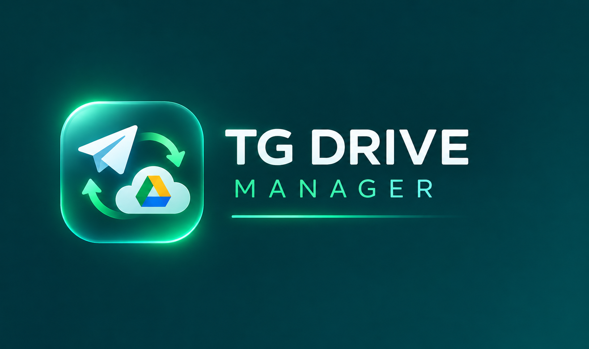
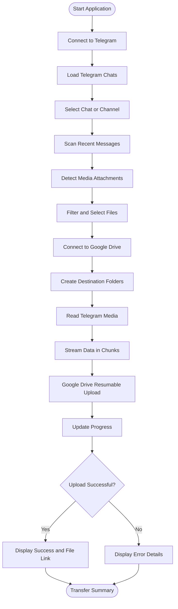

# ☁️ Telegram to Google Drive Manager

<p align="center">
  
</p>

<p align="center">
  <b>Transfer your Telegram media directly to Google Drive.</b>
  <br>
  Browse chats, select files, and upload them using direct streaming without downloading complete files to your computer.
</p>

<p align="center">
  
  
  
  
  
</p>

---

## 📌 Overview

**Telegram to Google Drive Manager** is a Python-based web application built with Streamlit that makes transferring files from Telegram to Google Drive easier.

The application connects to a Telegram account, retrieves available chats and channels, detects media attachments, and allows users to select files for uploading.

Its main feature is a streaming-based transfer mechanism. Instead of downloading an entire video or document to local storage before uploading, the application progressively reads Telegram media and transfers it to Google Drive in chunks.

The application also provides a modern, responsive interface featuring glassmorphism cards, animated gradient buttons, glowing effects, and a teal-green visual theme.

## ✨ Features

### Telegram Integration
- Connect to Telegram using Telethon.
- Authenticate using Telegram API credentials.
- Browse available Telegram chats and channels.
- Scan recent messages for attachments.
- Retrieve media information and file details.

### Media Management
- Detect videos, photos, and documents.
- Filter attachments by media category.
- Select individual files.
- Select all files in a filtered category.
- View filenames, sizes, and message information.

### Google Drive Integration
- Authenticate using Google OAuth 2.0.
- Connect to Google Drive through its API.
- Upload selected Telegram media.
- Automatically create destination folders.
- Organize files by Telegram chat and media type.
- Display Google Drive file links when available.

### Direct Streaming Technology
- Stream media directly from Telegram to Google Drive.
- Process files in smaller chunks.
- Avoid intentionally saving complete media files locally.
- Use Google Drive resumable upload sessions.
- Process transfers in a background worker.
- Display upload progress and transfer status.
- Report successful and failed uploads.

### Modern User Interface
- Custom TG Drive Manager branding.
- Glassmorphism dashboard design.
- Animated gradient buttons.
- Floating cloud and upload animations.
- Responsive layout.
- Custom sidebar navigation.
- Live upload progress indicators.
- Modern media selection interface.

## 🎨 UI Design and Colour Palette

The interface uses a dark teal and mint-green design inspired by a modern technology dashboard.

| Colour | Hex Code | Usage |
|---|---|---|
| Mint | `#C1F6ED` | Light backgrounds and highlights |
| Deep Teal | `#02353C` | Sidebar and dark sections |
| Green | `#449342` | Accent elements |
| Teal | `#2EAF7D` | Buttons and progress indicators |
| Aqua | `#3FD0C9` | Glowing effects and gradients |

## 🛠️ Technology Stack

| Technology | Purpose |
|---|---|
| Python | Core application logic |
| Streamlit | Web application interface |
| Telethon | Telegram API integration |
| Google Drive API | Cloud file storage |
| Google OAuth 2.0 | Google authentication |
| Requests | HTTP resumable uploads |
| Threading | Background processing |
| Queue | Transfer progress communication |
| CSS3 | Custom interface and animations |

## 🏗️ Project Structure

```text
TELEGRAM_TO_GDRIVE_MANAGER/
│
├── app.py
│   └── Main Streamlit application
│
├── style.css
│   └── Custom styling, glass effects and animations
│
├── assets/
│   └── logo.png
│       └── TG Drive Manager branding
│
├── telegram_service.py
│   └── Telegram authentication, chat retrieval
│       and media streaming
│
├── google_drive_service.py
│   └── Google Drive authentication,
│       folder management and uploads
│
├── .streamlit/
│   └── config.toml
│       └── Streamlit theme configuration
│
├── requirements.txt
│   └── Python dependencies
│
├── .gitignore
│   └── Excludes private and unnecessary files
│
├── README.md
│   └── Project documentation
│
├── .env
│   └── Private API configuration (not committed)
│
├── credentials.json
│   └── Google OAuth credentials (not committed)
│
├── token.json
│   └── Google authentication token (not committed)
│
└── telegram_session.session
    └── Telegram login session (not committed)
```

## ⚙️ How the Application Works

### 1. Telegram Authentication

The application uses Telethon to connect to Telegram.

The user provides Telegram API credentials obtained from the Telegram developer portal. After authentication, the session is saved locally for subsequent connections.

### 2. Browse Telegram Chats

The application retrieves available Telegram chats and channels.

Users can select a conversation and specify how many recent messages should be scanned.

### 3. Detect Media Attachments

The application scans the selected chat and identifies supported attachments:

- Videos
- Photos
- Documents

The detected files are displayed with their filenames, sizes, and message information.

### 4. Select Files

Users can filter attachments by category and select individual files or all files in the current filter.

The application calculates the total selected file size before starting the transfer.

### 5. Google Drive Authentication

The application uses Google OAuth 2.0 to authorize access to Google Drive.

The Google Drive API is used to create folders and upload files to the configured destination.

### 6. Direct Streaming and Chunked Upload

This is the main functionality of the project.

Instead of downloading an entire file before uploading it, the application progressively reads media from Telegram.

The transfer process works as follows:

1. Retrieve the selected Telegram message.
2. Read its media progressively.
3. Process incoming data in chunks.
4. Pass the chunks through a queue to the upload worker.
5. Send the data to Google Drive using a resumable upload session.
6. Report progress to the Streamlit interface.

This approach reduces the need for local storage compared with downloading complete files before uploading.

### 7. Automatic Folder Organization

Files are organized by Telegram chat and media type.

Example:

```text
Google Drive/
│
└── BB M D3/
    │
    ├── Telegram Chat/
    │   ├── Videos/
    │   ├── Photos/
    │   └── Documents/
    │
    └── Another Chat/
        ├── Videos/
        ├── Photos/
        └── Documents/
```

### 8. Upload Monitoring

The application displays:

- Current file being transferred.
- Transfer progress percentage.
- Transferred data size.
- Transfer speed.
- Successful uploads.
- Failed uploads.
- Google Drive file links when returned.

The background worker communicates progress through a queue so that Streamlit UI updates happen in the main application thread.

## 🔄 Application Workflow



## 💻 Installation and Setup

### Prerequisites

Make sure you have:

- Python 3.10 or newer.
- Git installed.
- A Telegram account.
- Telegram API credentials.
- A Google account.
- A Google Cloud project with Google Drive API enabled.

### Step 1: Clone the Repository

```bash
git clone https://github.com/dEIOnTomsoN/TELEGRAM_TO_GDRIVE_MANAGER.git
```

Navigate into the project:

```bash
cd TELEGRAM_TO_GDRIVE_MANAGER
```

### Step 2: Create a Virtual Environment

```bash
python -m venv venv
```

Activate the environment on Windows:

```powershell
.\venv\Scripts\activate
```

For Linux or macOS:

```bash
source venv/bin/activate
```

### Step 3: Install Dependencies

```bash
pip install -r requirements.txt
```

### Step 4: Configure Telegram API

1. Visit https://my.telegram.org
2. Log in using your Telegram account.
3. Open **API Development Tools**.
4. Create an application.
5. Obtain your API ID and API Hash.

### Step 5: Configure Google Drive API

1. Visit https://console.cloud.google.com/
2. Create a Google Cloud project.
3. Enable the Google Drive API.
4. Configure the OAuth consent screen.
5. Create an OAuth Client ID.
6. Choose **Desktop App** as the application type.
7. Download the OAuth credentials.
8. Save the file as `credentials.json` in the project directory.
9. If the application is in Testing mode, add your Google account as a test user.

### Step 6: Configure Environment Variables

Create a `.env` file in the root directory.

Add the following configuration:

```env
API_ID=YOUR_TELEGRAM_API_ID
API_HASH=YOUR_TELEGRAM_API_HASH
PHONE=YOUR_TELEGRAM_PHONE_NUMBER

GOOGLE_DRIVE_FOLDER_ID=YOUR_GOOGLE_DRIVE_FOLDER_ID
```

Replace the placeholder values with your own configuration.

**Never publish your `.env` file or authentication credentials.**

### Step 7: Run the Application

```bash
streamlit run app.py
```

Open your browser:

```text
http://localhost:8501
```

## 📂 Configuration

The application uses the following configuration files:

| File | Description |
|---|---|
| `.env` | Telegram and Google Drive environment configuration |
| `credentials.json` | Google OAuth client credentials |
| `token.json` | Google authentication token |
| `telegram_session.session` | Saved Telegram authentication session |
| `.streamlit/config.toml` | Streamlit theme settings |
| `requirements.txt` | Python dependencies |

The private authentication files are generated or configured locally and should not be included in the public repository.

## 🔐 Security and Privacy

This application interacts with personal Telegram and Google accounts. Protect all authentication information.

The following files must never be uploaded to GitHub:

```gitignore
venv/
__pycache__/
downloads/
.env
credentials.json
token.json
*.session
*.session-journal
```

Additional recommendations:

- Never share your Telegram API Hash.
- Never publish your Telegram session file.
- Never expose Google OAuth tokens.
- Keep credentials outside version control.
- Use your own Telegram and Google accounts when configuring the application.

## ⚡ Performance and Storage

The application uses progressive media streaming and chunked uploads to avoid intentionally saving complete files locally.

Transfer performance depends on:

- Internet connection speed.
- Telegram download performance.
- Google Drive upload performance.
- File size.
- Available system resources.
- Google API and Telegram service limits.

The application still requires an active internet connection throughout the transfer.

## ⚠️ Limitations

- The computer must remain powered on while running the local application.
- An active internet connection is required.
- Telegram and Google authentication must be configured correctly.
- OAuth tokens may need to be renewed if expired or revoked.
- Large transfers may take time depending on network conditions.
- Interrupted transfers may need to be retried; automatic recovery is not guaranteed.
- The current application is a local Streamlit web application, not a standalone Android application.

## 🚀 Future Enhancements

Planned improvements include:

- [ ] Android mobile application.
- [ ] Upload history and transfer logs.
- [ ] Automatic retry for failed uploads.
- [ ] Improved pause and resume functionality.
- [ ] Multiple file upload management.
- [ ] Better upload speed monitoring.
- [ ] Configurable Google Drive destinations.
- [ ] Improved mobile experience.
- [ ] Transfer queue management.

## 👨‍💻 Author

**Deion Tomson**

Computer Science and Engineering Graduate

- GitHub: https://github.com/dEIOnTomsoN
- Repository: https://github.com/dEIOnTomsoN/TELEGRAM_TO_GDRIVE_MANAGER

## ⭐ Support

If you find this project useful, consider giving the repository a star on GitHub!

## 📄 License

No open-source license has been specified yet. Add a `LICENSE` file if you decide to distribute this project under a particular license.

---

<p align="center">
  <b>☁️ TG DRIVE MANAGER</b>
  <br>
  Telegram → Google Drive
  <br>
  <i>Transfer smarter. Store better.</i>
</p>